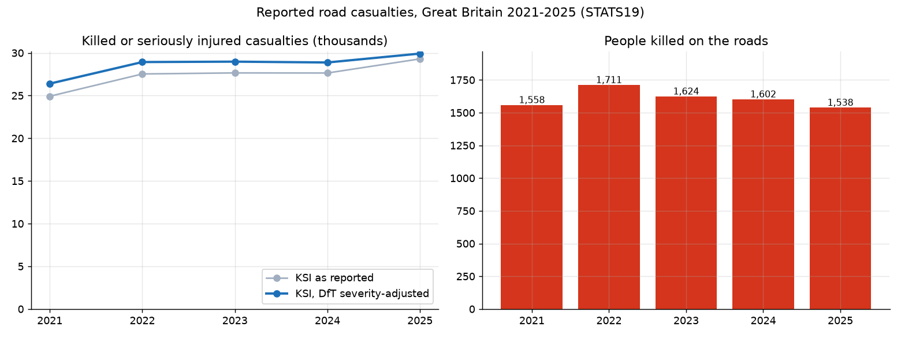
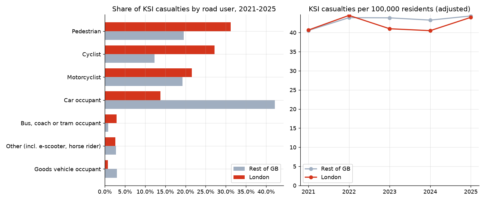
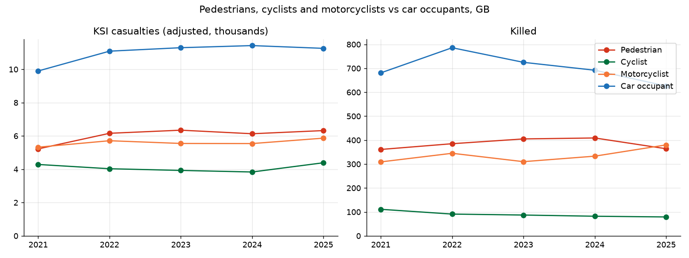
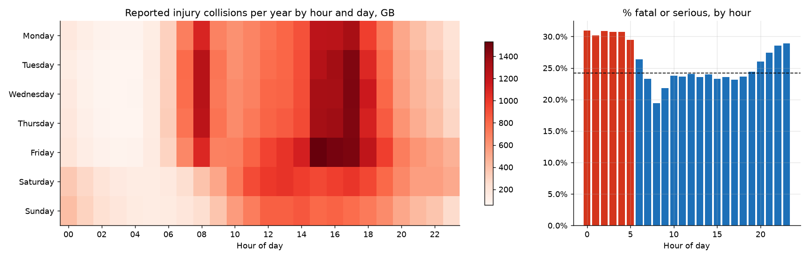
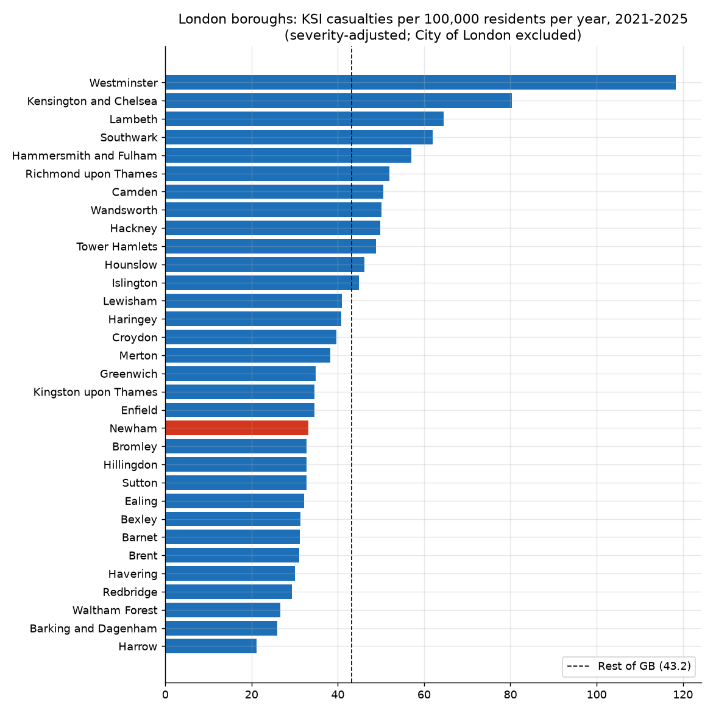
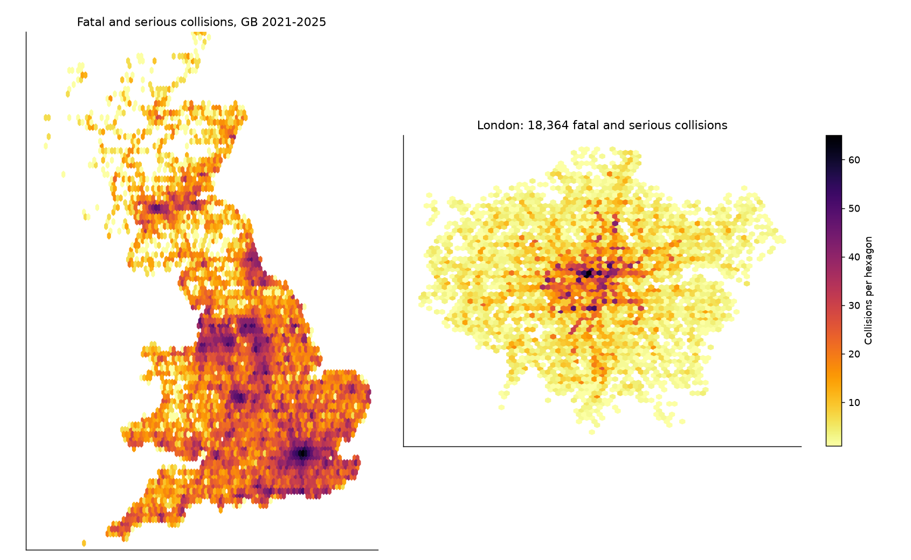
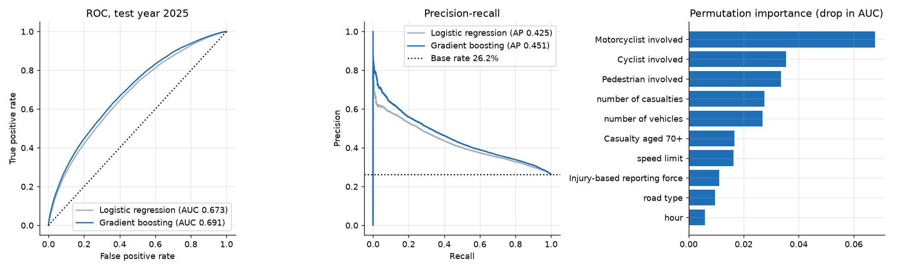

# Great Britain road safety: who gets hurt, where and when (STATS19, 2021 to 2025)

An end-to-end analysis of every police-reported injury road collision in Great Britain from 2021 to 2025
(513,801 collisions, 652,821 casualties), using the Department for Transport's STATS19 open data. The project
goes from raw government CSVs to SQL analysis, population-based rates for every local authority, maps, a
severity classification model and an interactive Streamlit dashboard. There is a focus on London and on
vulnerable road users.

Author: Anthony Adusei-Poku ([@anthony07-max](https://github.com/anthony07-max))



## Key findings

| Great Britain | 2021 | 2025 |
|---|---|---|
| Reported casualties | 128,209 | **127,883** |
| Killed | 1,558 | **1,538** (peak 1,711 in 2022) |
| Killed or seriously injured (KSI), as reported | 24,921 | **29,296** |
| KSI, DfT severity-adjusted | 26,397 | **29,918** (+13.3%) |
| Collisions from forces using injury-based (CRASH) reporting | 49.6% | **86.5%** |

1. **Deaths are flat, but serious injuries are rising.** 8,033 people were killed in 2021 to 2025. Reported KSI rose
   by 17.6%, but much of that rise comes from more police forces moving to injury-based reporting, which records
   more injuries as "serious". On the DfT's severity-adjusted basis, which corrects for this, KSI still rose
   by 13.3%.
2. **London has more casualties per resident but fewer deaths.** London had 284 casualties per 100,000 residents per year,
   against 183 in the rest of GB. Its KSI rate was almost the same (42.1 vs 43.2), but its death rate was less than half
   (1.1 vs 2.6 per 100,000). This fits slower urban speeds. 486 people died on London's roads over the five years.
3. **In London, 4 in 5 serious casualties are pedestrians, cyclists or motorcyclists.** These three groups make up 79.9% of
   London's KSI casualties, against 51.1% in the rest of GB. Pedestrians are the largest group in London (31.2%) and cyclists
   are 27.2%, against 12.3% elsewhere. Car occupants are only 13.8% of London's KSI, against 42.2% elsewhere.
4. **Motorcyclist deaths rose from 309 to 380 (+23%)** between 2021 and 2025, while cyclist deaths fell from 111 to 79.
   Across GB, half (50.4%) of everyone killed was a pedestrian, cyclist or motorcyclist. Severity-adjusted KSI
   among e-scooter users rose from 331 to 420.
5. **Collisions peak in the weekday afternoon, but night-time ones are the most severe.** The busiest hour is Friday
   15:00 to 15:59 (about 1,534 collisions a year). Between 00:00 and 05:59, 30.5% of collisions are fatal or serious,
   against 19.4% in the 08:00 hour and 24.2% overall.
6. **Local authority rates (per 100,000 residents per year, severity-adjusted).** Among London boroughs, Westminster (118.3),
   Kensington & Chelsea (80.4) and Lambeth (64.5) are highest. These are inflated by commuters and visitors who do not live there.
   Harrow (21.2), Barking & Dagenham (26.0) and Waltham Forest (26.7) are lowest. Newham is 33.2. Across GB areas with 100k+
   residents, Powys (118.8) and East Lindsey (102.1) are highest, which reflects rural roads at high speed.
7. **Severity model.** A class-weighted gradient boosting model trained on 2021 to 2024 and tested on 2025 (base rate 26.2%)
   gets **ROC AUC 0.691 and PR AUC 0.451**, against 0.673 and 0.425 for logistic regression. At the default threshold
   it catches 75.3% of serious collisions at 35.0% precision. This is a modest result, and the README says so plainly:
   severity depends heavily on things STATS19 does not record, such as impact speed. The strongest predictors are
   whether a motorcyclist, cyclist or pedestrian was involved, then the number of casualties and vehicles.

| | |
|---|---|
|  |  |
|  |  |




## Method
- **Download** (`src/download.py`): the DfT "last 5 years" collision and casualty files, the DfT data guide (code
  lookups) and ONS mid-year population estimates for every local authority, 2021 to 2025, from the Nomis API.
- **Clean** (`src/clean.py`): decodes STATS19 codes with the official data guide, parses dates and times, and groups
  casualty types into road-user groups. It also moves local authority codes onto April 2023 boundaries
  (Cumberland, Westmorland & Furness, North Yorkshire and Somerset mergers, plus Heathrow into Hillingdon) so that every
  collision joins to a population.
- **Analyse** (`src/analysis.py`): SQL (SQLite) aggregations, rates per 100,000 residents using population-years,
  hexbin maps, and charts.
- **Severity adjustment:** DfT publishes, for each casualty, the probability that the casualty would have been recorded as
  serious under injury-based reporting. Adjusted KSI is fatal plus the sum of those probabilities. It is used for trend
  and area comparisons because forces moved onto CRASH at different times.
- **Model:** one row per collision, with the target fatal or serious. Features are road, junction, light, weather, surface,
  speed limit, time, number of vehicles and casualties, which road users were involved, and whether the force uses
  injury-based reporting. The split is by time (train 2021 to 2024, test 2025), not random. Class imbalance is handled with
  `class_weight="balanced"`. Metrics are ROC AUC, PR AUC against the base rate, and precision and recall. Feature
  importance is permutation importance on held-out data.

## Data sources and licences
- Department for Transport, [Road Safety Data (STATS19)](https://www.data.gov.uk/dataset/cb7ae6f0-4be6-4935-9277-47e5ce24a11f/road-safety-data),
  [GOV.UK road safety open data page](https://www.gov.uk/government/statistical-data-sets/road-safety-open-data) and the
  2025 open data guide. © Crown copyright, [Open Government Licence v3.0](https://www.nationalarchives.gov.uk/doc/open-government-licence/version/3/).
- Office for National Statistics, mid-year population estimates by local authority (dataset NM_2002_1), via
  [Nomis](https://www.nomisweb.co.uk/). Source: Office for National Statistics, licensed under the Open Government Licence v3.0.

## Project structure
```
src/download.py      # fetches raw files into data/raw/ (about 150 MB, not committed)
src/clean.py         # decoding, boundary harmonisation, joins -> data/processed/
src/analysis.py      # SQL analysis, rates, maps, severity model, charts, key_findings.json
app/streamlit_app.py # interactive dashboard (trends, time patterns, local authorities, map, model)
charts/              # PNG outputs
data/processed/      # tidy tables used by the dashboard
```

## How to run
```bash
python -m venv .venv && source .venv/bin/activate
pip install -r requirements.txt
./run_pipeline.sh                      # download, clean, analyse (a few minutes)
streamlit run app/streamlit_app.py     # dashboard at http://localhost:8501
```

## Limitations
- STATS19 covers only **injury collisions reported to the police**. Many non-fatal injuries, especially to cyclists,
  are never reported, so these figures undercount.
- The move to injury-based reporting breaks the time series. Reported KSI should not be compared across years without
  the DfT severity adjustment, and the adjustment is a modelled estimate.
- Rates use **resident** population. Areas with many commuters, shoppers or tourists (Westminster, City of London,
  Kensington & Chelsea) or busy through-roads look worse per resident than per journey. Traffic volume (vehicle-km)
  would be a better denominator for road risk.
- Recording practice still differs between police forces, even after adjustment. For example, Welsh authorities have
  some of the lowest rates.
- The severity model is descriptive. It shows what is associated with severity in recorded collisions, not what causes it,
  and its AUC of about 0.69 means it should not be used to triage individual incidents.
